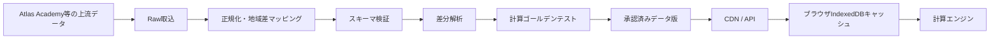
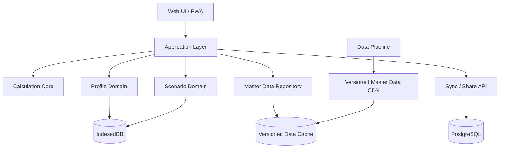

# FGO Lab 要件定義書

> **この文書は旧版です。** 実装上の正本は `docs/requirements/fgo-lab-requirements-v0.3.md` v0.3.0です。本書は初期検討の履歴としてのみ参照します。

> Fate/Grand Order向けの非公式ファンツールとして、ユーザーの保有・育成状況を基点に、ダメージ計算、編成比較、周回検証を一貫して行えるWebアプリケーションを定義する。

## 0. 文書情報

| 項目 | 内容 |
|---|---|
| 文書名 | FGO Lab 要件定義書 |
| バージョン | 0.2.2 |
| 作成日 | 2026-08-23 |
| 更新日 | 2026-08-24 |
| ステータス | 初期要件案 |
| プロジェクト名 | FGO Lab |
| 技術識別子 | `fgo-lab` |
| 初期対象 | FGO日本版、モダンブラウザ、スマートフォン／PC |
| 中核価値 | 「自分の手持ちで、どの条件なら倒せるか」を最短操作で判断できること |
| 主要モジュール | 所持・育成管理、ダメージ計算、編成・敵設定、比較・共有、3ターン周回検証 |
| 変更概要 | プロジェクト名をFGO Labへ確定し、技術識別子と構成例を統一 |

## 0.1 プロジェクト名称・識別子

| 用途 | 採用表記 |
|---|---|
| 正式表示名 | **FGO Lab** |
| リポジトリ名 | `fgo-lab` |
| 内部プロジェクトID | `fgo-lab` |
| npmスコープ候補 | `@fgo-lab/*` |
| サイトタイトル | `FGO Lab｜手持ち連動型ダメージ・周回計算ツール` |
| サブタイトル | `自分のカルデアで、倒せるかをすぐ計算。` |
| 英語説明 | `FGO roster-linked battle calculation and farming analysis tool` |

### 表記ルール

- 画面、文書、OGP、公開資料では `FGO Lab` と表記する。
- リポジトリ、ディレクトリ、パッケージ、環境変数の接頭辞では `fgo-lab` を使用する。
- `FGO-Lab`、`FGOLab`、`FGO LAB`などの異表記は原則使用しない。
- 正式名称だけでは機能が伝わりにくいため、検索結果や初回訪問画面では説明文を併記する。
- 既存のChaldeaプロジェクトや公式サービスと誤認される表現・デザインを避ける。

---

# 1. エグゼクティブサマリー

本プロダクトは、既存のFGOダメージ計算サイトに多い「大量の数値入力欄へ、ユーザーが攻略情報を見ながら手入力する」形式を改め、次の流れを一続きにする。

1. ユーザーが自身のサーヴァント・概念礼装・育成状況を保存する。
2. 保存済みの実ステータスから攻撃役を選択する。
3. 支援役、礼装、敵、クエスト条件を視覚的に設定する。
4. ダメージ、撃破確率、NP回収、比較差分を即時に確認する。
5. 条件を保存・複製・共有し、別編成や育成後の状態と比較する。

プロダクトの中心は、単なる「ダメージ計算機」ではなく、**保有データを再利用する戦闘検証ワークスペース**とする。

初期リリースでChaldea相当の全機能を再現してはならない。まず以下の2領域に集中する。

- **所持・育成管理**：保有・育成状態を高速に登録・更新・保存する。
- **ダメージ計算**：保存データを使って、宝具・通常攻撃・クリティカルの結果を比較する。

3ターン周回、NP回収、素材計画、スキル検索などは、共通プロフィールと共通計算エンジンを再利用する追加モジュールとして段階的に実装する。

---

# 2. 背景と課題

## 2.1 現状認識

AppMediaの宝具ダメージ計算ツールでは、サーヴァント、ATK、宝具レベル、宝具倍率、礼装ATK、相性、各種バフ・デバフ、特殊耐性、特攻などを入力し、複数条件を比較できる。一方、ユーザー自身の保有・育成状態と恒久的には結びついておらず、条件を変えるたびに手入力や再確認が発生する。[R1][R2]

また、AppMedia上ではダメージ、NP回収、即死、スリップダメージ、所持チェッカー、素材、種火、サーヴァントコイン、育成状況などが別々のツールとして提供されている。[R3] この分割は個々の機能を見つけやすい反面、同じサーヴァント情報を複数箇所で再入力しやすい。

Chaldeaは、サーヴァント・礼装・コマンドコード等の管理、素材計画、クエスト、編成保存、戦闘シミュレーションを広く備え、現在値・目標値を編成設定へ反映できる。[R4][R5][R6] 一方、機能密度が高く、単純に「この敵を宝具で倒せるか」を調べるだけでも、ユーザーが概念モデルや操作方法を理解する必要がある。

## 2.2 解決すべき主要課題

| ID | 課題 | 影響 |
|---|---|---|
| P-01 | 数式上の項目名がそのまま入力欄として並ぶ | 初心者が何を入力すべきか判断しにくい |
| P-02 | 保有・育成状態を毎回入力する | 計算開始までが遅く、入力ミスが増える |
| P-03 | 支援スキルを数値へ置き換えて入力する | スキルレベル、対象、持続、重複を誤りやすい |
| P-04 | 複数条件の比較が「別タブ」に留まる | 何が違い、なぜ結果が変わったか把握しにくい |
| P-05 | 結果が最小・平均・最大値だけになりやすい | 「敵HPを何％で倒せるか」という意思決定に直結しない |
| P-06 | ダメージ、NP回収、周回、育成管理が分断される | 同じデータを再利用できず、ツール間を往復する |
| P-07 | 特殊宝具や新機能追加時に計算式が壊れやすい | 更新遅延や誤計算が発生する |
| P-08 | 手持ちデータの登録自体が面倒 | 保存機能があっても利用されない |
| P-09 | 高機能化に伴いUIが複雑化する | 機能は豊富だが目的到達が遅い状態になる |
| P-10 | 計算根拠と前提が見えない | 結果を信頼しにくく、誤設定にも気づきにくい |

---

# 3. 既存ツール調査と採用方針

## 3.1 比較結果

| ツール | 主な強み | 主な不足・注意点 | 本プロダクトへの反映 |
|---|---|---|---|
| AppMedia 宝具／通常ダメージ計算 [R1][R2] | 日本語、主要補正を網羅、複数条件比較、簡易プリセット | 手入力中心、保有状態と非連携、比較差分が弱い | 入力項目の網羅性を参考にしつつ、保有データ自動反映と差分比較へ置換 |
| AppMedia お役立ちツール群 [R3] | 国内ユーザーの主要ニーズを広く把握できる | 機能が別ページに分散 | 共通プロフィールを基盤に、関連機能だけをモジュール化 |
| Chaldea / Laplace [R4][R5][R6] | 保有・育成管理、素材計画、編成保存、戦闘シミュレーション、地域別強化状態 | 高機能ゆえ学習コストが高い。コードはAGPL-3.0 | データモデル、計算対象、現在値／目標値の概念を参考にする。UI構造は再設計 |
| GamePress Command Chain Calculator [R7] | コマンドカード列ごとのダメージ・NP・スター比較 | 更新時期が古く、入力密度が高い | コマンドチェイン比較を将来モジュールとして採用 |
| FGO 3T Damage Calculator / Simulator [R8] | サーヴァント・礼装・3Wave敵を保存し、ダメージとNP回収を検証 | UI・データ更新・特殊処理の拡張性に課題 | 3ターン周回モジュールの最小ユースケースとして採用 |
| Fate/Grand Planner / Farming Hell [R9][R10] | 保有・素材・育成目標管理 | 戦闘計算との接続が弱い | ダメージ計算から「この育成後なら届く」を目標計画へ接続 |
| Atlas Academy API [R11] | FGOマスターデータの構造化配布 | 外部サービス依存、利用条件の確認が必要 | マスターデータ候補。計算時の直接依存ではなく、版管理した取込パイプラインを構築 |

## 3.2 採用する方針

- 保有・育成情報を全機能の共通データとして扱う。
- 現在値と目標値を分離し、計算時に切り替えられるようにする。
- 計算条件を「攻撃役」「編成・支援」「敵・クエスト」「ターン」「追加補正」に分ける。
- 基本モードと詳細モードを明確に分ける。
- 計算結果と同時に、前提・適用バフ・計算内訳・警告を表示する。
- 条件比較を第一級機能とし、複製・差分・ランキング・必要条件逆算を提供する。
- 計算エンジンとUIを分離し、純粋関数としてテスト可能にする。
- 新規の特殊宝具・特殊クエストを、データ駆動または明示的な拡張ポイントで追加する。

## 3.3 初期には採用しないもの

- Chaldea全体の機能を一度に再実装すること。
- ゲームアカウントのパスワード、引き継ぎ情報、セッショントークンを扱うこと。
- HTTPS通信傍受を前提としたアカウント取り込み。
- 敵AIまで含む完全なFGO戦闘エミュレーター。
- Tier表、ガチャシミュレーター、掲示板など、ダメージ・育成データとの結合が弱い機能。
- AppMedia等の画面・データを直接スクレイピングして複製すること。

---

# 4. プロダクトビジョン

本プロダクトの正式名称を **FGO Lab** とする。名称は単一機能の計算機に限定せず、保有管理、戦闘計算、比較、周回検証、育成計画を段階的に収容できる実験・検証環境を表す。

## 4.1 ビジョン

> 数値を入力する計算機ではなく、自分のカルデアで攻略可能性を検証する作業台をつくる。

## 4.2 提供価値

| 価値 | 説明 |
|---|---|
| 入力削減 | 所有サーヴァントを選ぶだけで、レベル、宝具、フォウ、スキル、アペンド、礼装を反映 |
| 判断支援 | ダメージ値だけでなく、撃破確率、余剰／不足ダメージ、必要育成、代替候補を提示 |
| 比較容易性 | NPレベル、礼装、支援、育成前後などの差を1画面で比較 |
| 説明可能性 | 適用された補正、適用されなかった効果、仮定、データ版を確認可能 |
| 再利用性 | 同じ保有データをダメージ、NP回収、3ターン、素材計画へ再利用 |
| 更新耐性 | マスターデータと計算式を版管理し、新規要素を安全に追加 |

## 4.3 UX原則

1. **目的から始める**：「宝具火力を見る」「この敵を倒せるか」「手持ちを比較する」「3ターンを組む」から開始する。
2. **保存値を既定にする**：登録済みなら手入力より保有状態を優先する。
3. **詳細は段階的に開示する**：一般的な条件だけで結果を出し、特殊補正は必要なときだけ展開する。
4. **即時計算する**：基本入力の変更後に計算ボタンを要求しない。
5. **差分を見せる**：結果値だけでなく、シナリオ間で変わった入力と寄与を表示する。
6. **推測を隠さない**：未対応・近似・手動上書き・データ欠落を明示する。
7. **アイコンだけに依存しない**：画像には名称、状態、ツールチップ、アクセシブルラベルを付ける。
8. **モバイルを縮小版にしない**：スマートフォンでは入力と結果を段階表示し、下部に結果サマリーを固定する。
9. **戻せる操作にする**：自動保存、Undo、リセット範囲の選択を提供する。
10. **機能数より到達時間を優先する**：主要タスクを少ない操作で完了できることを優先する。

---

# 5. ゴール・非ゴール

## 5.1 ゴール

| ID | ゴール |
|---|---|
| G-01 | 登録済みユーザーが10秒以内を目安に最初のダメージ結果へ到達できる |
| G-02 | 未登録ユーザーでも30秒以内を目安に代表的な宝具ダメージを確認できる |
| G-03 | 保有サーヴァントの実育成値を自動反映できる |
| G-04 | 最小・平均・最大に加え、敵HPに対する撃破確率または成功範囲を表示できる |
| G-05 | 編成・礼装・宝具レベル・育成状態を並列比較できる |
| G-06 | 計算結果の根拠と適用効果を追跡できる |
| G-07 | 一般的な宝具・通常攻撃・クリティカル計算をゲーム挙動と一致させる |
| G-08 | マスターデータと計算ロジックを版管理し、過去シナリオを再現できる |
| G-09 | ゲスト状態でも全P0機能を利用できる |
| G-10 | 同一プロフィールを将来のNP回収・3ターン・育成計画に再利用できる |

## 5.2 非ゴール

- 公式ゲームクライアントとのリアルタイム同期。
- 全クエストの敵AIと行動順を完全再現すること。
- 攻略記事、掲示板、ガチャ評価を包括する総合攻略メディア。
- 初期段階で全地域・全言語・全過去バージョンを完全対応すること。
- 自動編成AIが常に最適解を保証すること。
- ゲーム画像や音声を権利確認なく再配布すること。

---

# 6. 対象ユーザーと主要ユースケース

## 6.1 ペルソナ

### U-01 周回編成を検証する中上級者

- 90++等の高HP敵を確殺できるか確認したい。
- 手持ちの宝具レベルや礼装レベルを毎回入力したくない。
- 最低乱数、NP回収、イベント特攻を重視する。

### U-02 手持ちで攻略可能か知りたい一般ユーザー

- 計算式の用語には詳しくない。
- サーヴァント、支援役、敵を選ぶだけで結果を見たい。
- 「あと何が足りないか」を知りたい。

### U-03 育成・ガチャ判断を行う比較ユーザー

- 宝具1→2、Lv90→100、礼装Lv20→100の差を見たい。
- 未所持・仮想状態と現在の手持ちを比較したい。
- 育成コストとの接続を求める。

### U-04 検証・攻略情報を共有するユーザー

- 編成条件をURLや画像で共有したい。
- 他者が同じ結果を再現できることを重視する。
- データ版・計算式版・仮定を含めて共有したい。

## 6.2 ユースケース

| ID | ユースケース | 優先度 |
|---|---|---|
| UC-01 | 自分のサーヴァントの宝具ダメージを確認する | P0 |
| UC-02 | 敵HPに対する最低乱数・撃破確率を確認する | P0 |
| UC-03 | 礼装、支援役、宝具レベル、育成前後を比較する | P0 |
| UC-04 | 攻撃役に自身・支援役のスキルを適用する | P0 |
| UC-05 | クエストまたは手入力で敵情報を設定する | P0 |
| UC-06 | 条件を保存し、再利用する | P0 |
| UC-07 | 計算条件をURLで共有する | P0 |
| UC-08 | 所持サーヴァントを一覧・一括編集する | P0 |
| UC-09 | 宝具によるNP回収量を確認する | P1 |
| UC-10 | 3Waveの3ターン周回成立性を確認する | P1 |
| UC-11 | 通常カード列のダメージ・NP・スターを比較する | P2 |
| UC-12 | 育成目標と必要素材を確認する | P2 |
| UC-13 | 即死、毒・呪い・やけどを計算する | P2 |
| UC-14 | 所持サーヴァントから条件を満たす候補をランキングする | P1 |

---

# 7. 情報設計

## 7.1 全体ナビゲーション

| ナビゲーション | 役割 | MVP |
|---|---|---:|
| ホーム | 最近使った条件、保有登録進捗、クイック開始 | 対象 |
| ダメージ計算 | 宝具・通常攻撃・比較・撃破判定 | 対象 |
| 所持・育成管理 | サーヴァント、礼装、育成、恒常補正の管理 | 対象 |
| 編成・保存条件 | 保存編成、支援セット、敵セット、最近使用 | 対象 |
| 3ターン周回 | 3Waveのダメージ・NP回収・行動検証 | Phase 1 |
| データ検索 | サーヴァント、礼装、スキル効果検索 | Phase 1 |
| 育成計画 | 現在値／目標値、素材・種火・コイン | Phase 2 |
| 設定 | アカウント、地域、同期、表示、データ版 | 対象 |

## 7.2 ホーム画面

ホーム画面は「機能一覧」ではなく、次の作業を始めるランチャーとする。

- 「宝具で倒せるか調べる」
- 「手持ちを比較する」
- 「3ターン編成を検証する」
- 「保有状況を登録・更新する」
- 最近使ったシナリオ
- ピン留めした編成・敵・サーヴァント
- データ更新のお知らせと既知の計算上の注意

## 7.3 ダメージ計算画面

### PC

```text
┌────────────────────────────────────────────────────────────────┐
│ ヘッダー / モード / データ版 / 保存状態                         │
├─────────────────────────────────────┬──────────────────────────┤
│ 1. 攻撃役                            │ 結果サマリー（固定）      │
│ 2. 編成・支援                        │ ・最小 / 平均 / 最大       │
│ 3. 敵・クエスト                      │ ・撃破確率 / 不足量        │
│ 4. 条件・ターン                      │ ・NP回収 / スター          │
│ 5. 詳細補正（折りたたみ）            │ ・警告 / 前提              │
├─────────────────────────────────────┼──────────────────────────┤
│ 比較シナリオカード / 入力差分         │ 内訳 / 比較 / グラフ        │
└─────────────────────────────────────┴──────────────────────────┘
```

### スマートフォン

```text
[攻撃役] → [編成] → [敵] → [詳細]

入力カード
入力カード
入力カード

[固定結果バー: 平均 000,000 / 撃破 85%]
  └ タップで結果シートを展開

[保存] [複製] [比較]
```

スマートフォンでは入力中に結果が消えないよう、画面下部へ要約を固定する。詳細結果はボトムシートまたは専用タブで表示する。

---

# 8. 機能要件

優先度は以下とする。

- **P0**：MVP公開に必須
- **P1**：公開後の中核拡張
- **P2**：利用価値を広げる拡張
- **P3**：調査・需要検証後に判断

## 8.1 アカウント・プロフィール

| ID | 要件 | 優先度 |
|---|---|---:|
| FR-ACC-001 | 初回利用時は登録を要求せず、ローカルプロフィールを自動作成する | P0 |
| FR-ACC-002 | 任意でクラウドアカウントへ昇格し、複数端末同期できる | P0 |
| FR-ACC-003 | JP、NA等のゲーム地域をプロフィール単位で保持する | P0 |
| FR-ACC-004 | 複数のゲームアカウント／検証用プロフィールを切り替えられる | P1 |
| FR-ACC-005 | ローカル変更を自動保存し、保存中・保存済み・競合状態を表示する | P0 |
| FR-ACC-006 | JSONで全ユーザーデータをエクスポート・復元できる | P0 |
| FR-ACC-007 | CSVで主要育成値を一括編集・再取込できる | P1 |
| FR-ACC-008 | ユーザーがクラウドデータを完全削除できる | P0 |
| FR-ACC-009 | スキーマ移行前に自動バックアップを作成し、失敗時に復旧できる | P0 |
| FR-ACC-010 | 同期競合時は端末間の差分を表示し、項目単位で選択できる | P1 |

## 8.2 所持・育成管理：サーヴァント管理

| ID | 要件 | 優先度 |
|---|---|---:|
| FR-SVT-001 | 全サーヴァントを名前、クラス、レアリティ、宝具色、範囲、特性で検索・絞込できる | P0 |
| FR-SVT-002 | 宝具Lv 0を未所持、1〜5を所持として扱い、詳細編集から変更できる | P0 |
| FR-SVT-003 | 所持サーヴァントについて現在値と目標値を保持する | P0 |
| FR-SVT-004 | レベル、霊基再臨、宝具レベル、スキル、アペンドスキルを保存する | P0 |
| FR-SVT-005 | ATK／HPフォウ、カード強化、コマンドコード、絆、聖杯状態を保存する | P0 |
| FR-SVT-006 | 強化状態を地域と公開日時から自動判定し、手動上書きも許可する | P0 |
| FR-SVT-007 | 変身・霊基変化・宝具切替をデータ駆動で扱える | P1 |
| FR-SVT-008 | グランド関連状態、クラススコア等の恒常補正を反映できる | P0 |
| FR-SVT-009 | PC向け一括編集は主画面と分離した補助表示として追加できる | P1 |
| FR-SVT-010 | 「全員最大」「配布は宝具5」等の初期値ルールを設定できる | P1 |
| FR-SVT-011 | ダメージに影響する未入力項目へ要確認バッジを表示する | P0 |
| FR-SVT-012 | 値が保有データ、自動推定、シナリオ上書きのどれに由来するか表示する | P0 |
| FR-SVT-013 | ChaldeaバックアップJSONの互換インポーターを提供できる構造にする | P1 |
| FR-SVT-014 | スクリーンショット認識は確認画面を伴う補助入力としてのみ検討する | P2 |

### 登録UI要件

- 初期状態ではマスターデータ上の全サーヴァントをNP0・未所持として横長一覧へ表示する。
- 初期表示は全サーヴァントとし、所持のみ、未所持のみへ切り替えられる。
- 名前検索とキーボード操作だけでも登録できる。
- PCは左一覧と右詳細、SPは一覧から詳細サブページへの遷移で主要値を編集できる。左一覧には編集UIを置かない。
- 現在値と育成目標を別タブにし、スキルはDB由来の名称と画像を表示する。
- `Lv90`、`Lv100`、`Lv120`、`スキル全て10`のショートカットを提供する。
- 現在値から目標値への変更箇所を色だけでなく記号・数値で示す。
- 未所持サーヴァントも仮想比較用に選択できるが、未所持であることを常時表示する。

## 8.3 概念礼装・魔術礼装・コマンドコード

| ID | 要件 | 優先度 |
|---|---|---:|
| FR-EQP-001 | 使用する概念礼装を物理コピー単位で登録し、限界突破状態と個体ごとのレベルを保存できる | P0 |
| FR-EQP-002 | 礼装ATKを版付きマスターデータとレベルから自動算出する | P0 |
| FR-EQP-003 | 通常礼装、絆礼装、追加装備枠等をデータ駆動で扱える | P1 |
| FR-EQP-004 | 魔術礼装の所持・レベルを保存し、スキル効果を編成へ適用できる | P0 |
| FR-EQP-005 | コマンドコードの所持・装備を保存し、通常カード計算へ反映できる | P2 |
| FR-EQP-006 | イベント特攻礼装をクエスト選択時に上位へ表示する | P1 |
| FR-EQP-007 | 登録済みコピーと全礼装から作成した仮想状態を区別して計算へ適用できる | P0 |

## 8.4 ダメージ計算：クイック計算

| ID | 要件 | 優先度 |
|---|---|---:|
| FR-DMG-001 | 「宝具」「通常攻撃」「クリティカル」「チェイン」の計算種別を選択できる | P0（チェインはP2） |
| FR-DMG-002 | サーヴァント選択時に保有プロフィールから育成値を自動反映する | P0 |
| FR-DMG-003 | 未登録サーヴァントには設定済みの既定育成値を反映する | P0 |
| FR-DMG-004 | 自身のスキル・宝具前効果・パッシブを候補表示し、適用を切り替えられる | P0 |
| FR-DMG-005 | 支援役を選択し、対象スキルを数値入力なしで適用できる | P0 |
| FR-DMG-006 | 礼装・魔術礼装・イベント補正を選択式で適用できる | P0 |
| FR-DMG-007 | 敵のHP、クラス、属性、特性を設定できる | P0 |
| FR-DMG-008 | 入力変更後、結果を自動再計算する | P0 |
| FR-DMG-009 | 基本モードでは一般利用に必要な項目だけを表示する | P0 |
| FR-DMG-010 | 詳細モードでは全補正値をカテゴリ別に確認・上書きできる | P0 |
| FR-DMG-011 | 上書き項目を強調し、元の自動値へ個別に戻せる | P0 |
| FR-DMG-012 | 計算条件を名前付きシナリオとして保存できる | P0 |
| FR-DMG-013 | 直前の操作をUndo／Redoできる | P0 |
| FR-DMG-014 | 条件の一部だけをリセットできる | P0 |
| FR-DMG-015 | 代表的な支援編成をプリセット登録し、実際のスキルデータから値を生成する | P0 |

## 8.5 編成・支援・バフ管理

| ID | 要件 | 優先度 |
|---|---|---:|
| FR-PTY-001 | 前衛・控えを含む編成スロットを持つ | P1 |
| FR-PTY-002 | クイック計算では攻撃役＋任意数の支援役だけを簡易表示する | P0 |
| FR-PTY-003 | 各スキルの対象、使用ターン、持続ターン、回数、重複状態を保持する | P1 |
| FR-PTY-004 | 自身・全体・単体・敵等の対象範囲を自動適用する | P0 |
| FR-PTY-005 | 同種バフを攻撃、カード、宝具、特攻、特殊、固定値等へ自動集計する | P0 |
| FR-PTY-006 | バフ状態を「攻撃20%」「Arts50%」等のチップとして要約表示する | P0 |
| FR-PTY-007 | チップから付与元・対象・残りターン・計算カテゴリを確認できる | P0 |
| FR-PTY-008 | カスタムバフを名称、値、カテゴリ、対象、持続、メモ付きで追加できる | P1 |
| FR-PTY-009 | オーダーチェンジ等による編成交代を3ターン検証で扱える | P1 |
| FR-PTY-010 | フレンド支援は自分の保有値とは独立した育成値・礼装を保存できる | P0 |
| FR-PTY-011 | 宝具OC段階、OC増加、宝具チェインを設定できる | P0 |
| FR-PTY-012 | フィールド特性・味方／敵の特性付与を表示・反映できる | P1 |

## 8.6 敵・クエスト設定

| ID | 要件 | 優先度 |
|---|---|---:|
| FR-ENM-001 | 敵HP、クラス、属性、特性を手入力できる | P0 |
| FR-ENM-002 | 防御力、カード耐性、宝具耐性、特殊耐性、ダメージカット等を設定できる | P0 |
| FR-ENM-003 | 敵を最大3体まで同一Waveに配置できる | P0 |
| FR-ENM-004 | 全体宝具は各敵に対する相性・特性を個別計算する | P0 |
| FR-ENM-005 | クエスト検索からWave・敵情報を読み込める | P1 |
| FR-ENM-006 | イベント、フリークエスト、ストーリー等で絞込できる | P1 |
| FR-ENM-007 | クエストの地域・開催日時・データ版を保持する | P1 |
| FR-ENM-008 | 敵セットを保存・複製・共有できる | P0 |
| FR-ENM-009 | ブレイクゲージ、HP閾値、特殊状態を将来的に追加できる構造にする | P2 |
| FR-ENM-010 | 未反映の特殊耐性等がある場合、既知の注意を表示する | P1 |

## 8.7 計算結果・意思決定支援

| ID | 要件 | 優先度 |
|---|---|---:|
| FR-RES-001 | 最小、平均、最大ダメージを表示する | P0 |
| FR-RES-002 | 敵HP入力時、撃破確率または乱数範囲内の成功割合を表示する | P0 |
| FR-RES-003 | 最低乱数での余剰／不足ダメージを表示する | P0 |
| FR-RES-004 | 複数敵の場合、敵ごとの結果とWave全体の成功状態を表示する | P0 |
| FR-RES-005 | ヒットごとのダメージとオーバーキル開始位置を表示する | P1 |
| FR-RES-006 | NP回収量とスター期待値を表示する | P1 |
| FR-RES-007 | 攻撃、カード、クラス、属性、宝具、特攻、特殊、固定値の内訳を表示する | P0 |
| FR-RES-008 | 適用されなかったスキル効果と理由を表示する | P0 |
| FR-RES-009 | 未対応、近似、手動上書き、地域不一致を警告する | P0 |
| FR-RES-010 | 「NPレベルをいくつにすれば最低乱数で届くか」等を逆算する | P1 |
| FR-RES-011 | 必要な追加ATK、バフ、礼装ATK、育成レベルを逆算する | P1 |
| FR-RES-012 | 所持サーヴァントを同一条件で一括計算し、結果で並べ替える | P1 |
| FR-RES-013 | 結果表とグラフを切り替えられる | P1 |
| FR-RES-014 | グラフを使わなくても同等情報を表として取得できる | P0 |
| FR-RES-015 | エンジン版、マスターデータ版、計算日時、地域を結果へ記録する | P0 |

## 8.8 比較ワークスペース

| ID | 要件 | 優先度 |
|---|---|---:|
| FR-CMP-001 | 1つのシナリオを複製して比較条件を作成できる | P0 |
| FR-CMP-002 | 「現在」「宝具2」「黒聖杯」等の名前を付けられる | P0 |
| FR-CMP-003 | 入力差分を自動抽出し、変更項目だけを表示できる | P0 |
| FR-CMP-004 | 結果差、増加率、撃破確率差を表示する | P0 |
| FR-CMP-005 | 基準シナリオを指定できる | P0 |
| FR-CMP-006 | PCでは最大8条件、モバイルでは横スワイプまたは比較表で扱える | P1 |
| FR-CMP-007 | 一部条件を全シナリオへ一括適用できる | P0 |
| FR-CMP-008 | シナリオごとに保有値／目標値／仮想値を切り替えられる | P0 |
| FR-CMP-009 | 比較結果を画像またはMarkdown表として出力できる | P1 |

## 8.9 保存・共有

| ID | 要件 | 優先度 |
|---|---|---:|
| FR-SHR-001 | シナリオ、編成、支援セット、敵セットを個別に保存できる | P0 |
| FR-SHR-002 | 最近使用、ピン留め、タグ、検索を提供する | P0 |
| FR-SHR-003 | URLへ条件を埋め込むか、共有IDを発行できる | P0 |
| FR-SHR-004 | 共有時に保有一覧、プロフィール名、アカウント情報を含めない | P0 |
| FR-SHR-005 | 計算式版・データ版の違いを検出し、再計算可否を表示する | P0 |
| FR-SHR-006 | 共有条件を自分の保有値へ置き換えられる | P1 |
| FR-SHR-007 | 公開共有とリンク限定共有を分ける | P2 |
| FR-SHR-008 | 説明メモ、想定クエスト、操作順を添付できる | P1 |

## 8.10 3ターン周回モジュール

| ID | 要件 | 優先度 |
|---|---|---:|
| FR-3T-001 | 3Wave、各Wave最大3体の敵を設定できる | P1 |
| FR-3T-002 | 各ターンのスキル、宝具、対象、編成交代をタイムラインで設定できる | P1 |
| FR-3T-003 | Waveごとに最小・平均・最大ダメージと撃破成立を表示する | P1 |
| FR-3T-004 | 攻撃後NP、必要チャージ、不足NPをターンごとに表示する | P1 |
| FR-3T-005 | オーバーキル位置を考慮したNP回収を計算する | P1 |
| FR-3T-006 | スキル持続、回数、クールダウン、退場時効果を追跡する | P1 |
| FR-3T-007 | イベント特攻、礼装積載数、フレンド条件を保存する | P1 |
| FR-3T-008 | 成立条件を「最低乱数」「平均」「指定成功率」から選べる | P1 |
| FR-3T-009 | 同一編成で敵編成だけを差し替えられる | P1 |
| FR-3T-010 | 自動最適化は候補探索として提供し、最適性を保証しない | P2 |
| FR-3T-011 | 敵AI、ガッツ、ブレイク、複雑な退場順等は対応状況を明示する | P1 |

## 8.11 関連ツール統合方針

| 機能 | 位置付け | 優先度 | 共通プロフィールとの接続 |
|---|---|---:|---|
| 宝具NP回収 | ダメージ計算結果タブ | P1 | サーヴァント、礼装、スキル、敵を再利用 |
| コマンドチェイン計算 | ダメージ計算のモード | P2 | カード強化、コマンドコードを再利用 |
| スキル効果検索 | データ検索 | P1 | 所持のみ／育成済みのみで絞込 |
| 即死計算 | ダメージ計算の特殊計算 | P2 | 宝具・スキル・敵DRを再利用 |
| スリップダメージ | ダメージ計算の特殊計算 | P2 | スキル・敵状態を再利用 |
| 所持チェッカー | 所持・育成管理そのもの | P0 | 中核データ |
| 種火・EXP・コイン | 育成計画 | P2 | 現在値と目標値の差分を再利用 |
| 素材計算 | 育成計画 | P2 | スキル・アペンド・再臨目標を再利用 |
| フリクエ最適化 | 育成計画の補助 | P3 | 素材不足を入力にする |
| Tierメーカー／ガチャシミュレーター | 対象外 | - | 中核価値と接続しない |

## 8.12 データ運用・管理

| ID | 要件 | 優先度 |
|---|---|---:|
| FR-ADM-001 | マスターデータの取込版、検証版、公開版を分離する | P0 |
| FR-ADM-002 | 新旧データのサーヴァント、スキル、宝具、関数、定数差分を表示する | P0 |
| FR-ADM-003 | 計算影響がある変更を自動抽出する | P0 |
| FR-ADM-004 | 公開前にデータ検証とゴールデンテストを実行する | P0 |
| FR-ADM-005 | 問題のあるデータ版を即時ロールバックできる | P0 |
| FR-ADM-006 | 特定機能・特定サーヴァントを「既知の問題あり」と表示できる | P0 |
| FR-ADM-007 | 計算式、データ、翻訳、画像の出典を記録する | P0 |
| FR-ADM-008 | 機能フラグで新しい計算処理を限定公開できる | P1 |

---

# 9. 計算エンジン要件

## 9.1 基本設計

計算エンジンはUI、データ取得、保存処理から独立した純粋なドメインパッケージとする。

```text
CalcInput + MasterDataSnapshot + EngineVersion
                         ↓
                 deterministic calculate
                         ↓
CalcResult + Breakdown + Warnings + Trace
```

同一の入力、マスターデータ版、計算エンジン版からは常に同一結果を返す。

## 9.2 エンジン要件

| ID | 要件 | 優先度 |
|---|---|---:|
| CE-001 | 計算入力・出力をバージョン付きスキーマとして定義する | P0 |
| CE-002 | ゲーム挙動に必要な32-bit相当演算と丸め順を再現する | P0 |
| CE-003 | 各段階のfloor、上限・下限、加算順、乗算順をテスト可能に明文化する | P0 |
| CE-004 | ダメージ乱数はマスターデータ定数として扱う | P0 |
| CE-005 | 最小・平均・最大、および離散乱数ごとの結果分布を算出できる | P0 |
| CE-006 | 宝具・通常カード・クリティカル・Extra Attack・チェイン補正を分離する | P0 |
| CE-007 | NP回収・スター発生を独立した計算器として実装する | P1 |
| CE-008 | 1ヒットごとのダメージ、HP遷移、オーバーキル開始位置を追跡する | P1 |
| CE-009 | 全体宝具では敵ごとの相性、属性、特性、耐性を個別評価する | P0 |
| CE-010 | 未対応の特殊関数は未対応警告と影響範囲を返す | P0 |
| CE-011 | 手動上書き値は自動値と別フィールドで保持する | P0 |
| CE-012 | バフ上限・下限、防御無視、特殊耐性等の優先関係を処理する | P0 |
| CE-013 | 強化前後、地域差、クエスト日時差をデータスナップショットで切り替える | P0 |
| CE-014 | 適用関数、条件判定、最終値を追跡できるトレースを生成する | P0 |
| CE-015 | Web Workerで実行可能にし、一括比較でUIを停止させない | P1 |

## 9.3 対応する補正カテゴリ

- 基礎ATK、礼装ATK、フォウ、レベル・聖杯由来ATK
- 宝具倍率／カード倍率／ヒット配分
- クラス攻撃補正
- クラス相性
- 属性相性
- 攻撃力アップ／防御力ダウン
- カード性能アップ／カード耐性ダウン
- 宝具威力アップ／宝具威力耐性
- クリティカル威力アップ／クリティカル耐性
- 特攻状態付与による威力アップ
- 特攻宝具／宝具固有特攻倍率
- 特殊威力アップ／特殊耐性
- イベント特攻
- NP威力ブースト等の特殊増幅
- 固定ダメージ、与ダメージプラス、被ダメージカット
- 防御無視
- Busterチェイン、Mighty Chain、1st Bonus、カード順補正
- コマンドカード強化
- パッシブ、クラススコア、グランド系恒常補正
- フィールド・敵・味方の特性判定
- 宝具前後の効果適用順
- HP割合で変化する宝具
- 状態数、特性数、レアリティ、段階値等で変化する特殊宝具
- 変身・宝具切替・スキル強化差分

## 9.4 特殊処理の拡張モデル

```text
EffectFunction
├─ activationCondition
├─ targetSelector
├─ timing
├─ valueResolver
├─ modifierCategory
├─ stackingRule
├─ durationOrCount
└─ traceDescription
```

データだけで安全に表現できない処理は、明示的なハンドラーIDとテストを追加する。ハンドラー未実装時は「0として処理」せず、結果を不完全として扱う。

## 9.5 計算出力モデル

```ts
interface CalcResult {
  engineVersion: string;
  masterDataVersion: string;
  status: "exact" | "approximate" | "unsupported";
  damage: {
    min: number;
    average: number;
    max: number;
    distribution?: Array<{ randomValue: number; damage: number }>;
  };
  kill?: {
    targetHp: number;
    probability: number;
    minMargin: number;
    averageMargin: number;
  };
  perTarget: TargetResult[];
  perHit?: HitResult[];
  npRefund?: NpRefundResult;
  stars?: StarResult;
  breakdown: ModifierBreakdown[];
  assumptions: Assumption[];
  warnings: CalcWarning[];
  traceId?: string;
}
```

実装時はZod、JSON Schema等で厳密に定義する。

## 9.6 正確性方針

- Chaldeaの実装は、対応ケースと境界条件を知るための参考実装・挙動比較先として利用する。
- 数式・処理はAtlas Academyの公開資料、ゲーム内実測、独立したテストケースを用いて再構成する。
- Chaldeaのソースコードを流用・翻案する場合はAGPL-3.0の条件を事前確認する。
- 「Chaldeaと同じ結果」だけを正しさの唯一の根拠にしない。
- 境界値、負補正、上限超過、複数敵、強化前後を必ずテストする。

---

# 10. データ要件

## 10.1 マスターデータ

| エンティティ | 主な情報 |
|---|---|
| Servant | ID、名称、地域公開状態、クラス、属性、レアリティ、カード構成、特性 |
| ServantStat | レベル別ATK／HP、聖杯上限、フォウ補正 |
| Skill | レベル別効果、対象、タイミング、持続、強化状態、解放条件 |
| NoblePhantasm | 宝具色、範囲、レベル別倍率、OC、ヒット配分、前後効果、特殊関数 |
| Passive | クラススキル、追加パッシブ、イベントパッシブ |
| CraftEssence | レベル別ATK／HP、通常／最大解放効果、装備制約 |
| CommandCode | 効果、対象カード条件、所持・装備制約 |
| MysticCode | レベル別スキル効果、対象、持続 |
| Buff / Function | 効果種別、計算カテゴリ、条件、値、重複規則 |
| Trait | 特性ID、表示名、包含・否定・複合判定 |
| ClassRelation | クラス攻撃補正、攻防相性、特殊相性 |
| AttributeRelation | 天・地・人・星・獣等の相性 |
| GameConstant | 乱数、基礎攻撃率、チェイン補正、上限値等 |
| Quest | 地域、開催期間、Wave、フィールド特性、特殊条件 |
| Enemy | HP、クラス、属性、特性、NP補正、スター補正、耐性 |
| BoardBonus | クラススコア、グランド系ボード、恒常補正 |
| ReleaseMapping | 地域別の公開日時、強化・宝具・スキル優先度 |
| Translation | 日本語名、英語名、別名、検索用読み |

## 10.2 ユーザーデータ概念スキーマ

```ts
interface OwnedServantState {
  servantId: number;
  owned: boolean;
  current: ServantBuild;
  target?: ServantBuild;
  tags?: string[];
  favorite?: boolean;
  note?: string;
  updatedAt: string;
}

interface ServantBuild {
  level: number;
  ascension: number;
  npLevel: number;
  activeSkillLevels: number[];
  appendSkillLevels: number[];
  atkFou: number;
  hpFou: number;
  bondLevel?: number;
  cardStrengthen: number[];
  commandCodeIds: Array<number | null>;
  strengthenOverrides?: Record<string, boolean>;
  grandState?: Record<string, unknown>;
}
```

アペンド数、装備枠数、カード数等は固定長を前提にせず、マスターデータに従う。

```ts
interface OwnedCraftEssenceState {
  craftEssenceId: number;
  copies: Array<{
    level: number;
    limitBreak: number;
    locked?: boolean;
  }>;
  note?: string;
}
```

## 10.3 シナリオデータ概念スキーマ

```ts
interface DamageScenario {
  schemaVersion: string;
  name: string;
  region: string;
  masterDataVersion: string;
  engineVersion?: string;
  attacker: BuildReferenceOrOverride;
  party: PartyMemberConfig[];
  equipment: EquipmentConfig;
  enemyWave: EnemyConfig[];
  actions: ActionConfig[];
  manualModifiers: ManualModifier[];
  calculationMode: "np" | "normal" | "critical" | "chain";
  randomMode: "distribution" | "min" | "average" | "max" | "fixed";
  note?: string;
}
```

- **ローカル保存**：プロフィール参照を保持し、育成更新へ追従できる。
- **共有スナップショット**：共有時点の数値を埋め込み、他者が再現できる。

## 10.4 データパイプライン



### パイプライン要件

- 上流JSONをそのままUIへ渡さず、内部の正規化モデルへ変換する。
- 各データ版へ一意なバージョン、作成日時、上流版、チェックサムを付与する。
- 計算時に毎回外部APIへ接続しない。
- 前回正常版をブラウザへ保持し、更新失敗時も利用可能にする。
- 数式に影響する関数・定数差分は自動テストを必須とする。
- 画像と構造化データを分け、画像欠落でも計算・検索を利用可能にする。
- 上流サービス停止時に直近公開版で継続運用できる。
- 誤データ発覚時に前版へ戻せる運用手順を用意する。

---

# 11. UI／UX要件

## 11.1 タスク起点

初回表示で大量の計算項目を出してはならない。次の問いから開始する。

- この宝具はどれくらい出る？
- この敵を倒せる？
- 自分の手持ちでは誰が一番向いている？
- 礼装や宝具レベルを変えるとどうなる？
- 3ターン周回が成立する？

選択した問いに応じて、不要な入力を非表示にする。

## 11.2 基本モード

常時表示する項目は原則として以下に限定する。

1. 攻撃役
2. 育成値の出典（現在／目標／仮想）
3. 礼装
4. 支援役と使用スキル
5. 敵HP、クラス、属性またはクエスト
6. 宝具レベル／OC
7. 結果

「攻バフ」「色バフ」「宝具バフ」等の生数値は、選択したスキルから自動生成し、通常は要約チップとして表示する。

## 11.3 詳細モード

- 基礎ステータス
- 相性・属性
- 攻撃・防御
- カード性能
- 宝具・クリティカル
- 特攻・特殊補正
- 固定値・ダメージカット
- フィールド・特性
- 乱数・計算式

各数値欄には単位、有効範囲、自動算出元、上限・下限、説明、元へ戻す操作を付ける。

## 11.4 サーヴァント選択

- 所持・最近使用・ピン留めを上位表示する。
- 名前、別名、読み、クラス、宝具色、範囲で検索できる。
- 所持状態、宝具レベル、育成レベルを候補内に表示する。
- アイコン一覧だけでなく、名称を含むリスト表示を用意する。
- 長い一覧は仮想スクロールする。
- 「所持のみ」スイッチを目立つ位置に置く。

## 11.5 支援・スキル選択

悪い例：`攻撃力アップ 20`を別サイトで調べて入力する。

良い例：

```text
[アルトリア・キャスター Lv90 10/10/10]
  ☑ スキル1
  ☑ スキル2
  ☑ スキル3 → 対象: 攻撃役

適用中: 攻撃力+20% / Arts+50% / NP獲得量+30% / NP+50%
```

- スキル名、レベル、対象、主な効果を表示する。
- 発動不能・対象外の効果は無効表示し、理由を説明する。
- よく使う組み合わせはプリセット化できる。
- プリセット値を固定コピーせず、マスターデータから再生成する。

## 11.6 結果表示

```text
平均ダメージ      1,024,500
最低ダメージ        928,310
最大ダメージ      1,127,940
敵HP              1,000,000
撃破確率                63%
最低乱数時不足      71,690
```

その下で以下を展開できる。

- 乱数分布
- 敵ごとの結果
- 1ヒットごとの結果
- NP回収・スター
- バフ内訳
- 適用順・計算トレース
- 比較差分
- 警告・仮定

## 11.7 比較UI

無名タブを並べるのではなく、各条件を名前付きカードとして扱う。

```text
基準: 現在の手持ち
├─ NP1 / Lv90 / 黒聖杯Lv60
│  最低 92.8万  撃破63%
│
├─ NP2
│  最低 118.2万 撃破100%  +27.4%
│  差分: 宝具Lv 1 → 2
│
└─ 礼装Lv100
   最低 99.6万  撃破98%   +7.3%
   差分: 礼装ATK 1,582 → 2,400
```

## 11.8 警告設計

| 状態 | 表示例 |
|---|---|
| 未入力 | 「敵クラスが未設定のため、等倍として計算しています」 |
| 地域差 | 「この強化はJPでは実装済み、NAでは未実装です」 |
| 未対応 | 「宝具固有効果Xは未対応のため、結果は参考値です」 |
| 手動上書き | 「宝具倍率をマスターデータ値から上書きしています」 |
| 古いデータ | 「この共有条件は旧データ版で作成されました」 |
| 同期競合 | 「別端末で宝具レベルが変更されています」 |

## 11.9 アクセシビリティ

- WCAG 2.2 AA相当を目標とする。
- タッチターゲットは原則44×44px以上。
- キーボードだけで主要計算を完了できる。
- フォーカス位置を常に可視化する。
- Buster／Arts／Quickの色を唯一の識別手段にしない。
- グラフには代替表と要約文を付ける。
- 数値は桁区切りし、読み上げ用ラベルを用意する。
- `prefers-reduced-motion`へ対応する。

## 11.10 レスポンシブ

| 幅 | 基本レイアウト |
|---|---|
| 〜599px | 1カラム、結果固定バー、セクション式入力、ボトムシート |
| 600〜1023px | 1〜2カラム切替、結果サイドシート |
| 1024px〜 | 入力＋固定結果の2カラム、比較表常時表示 |

---

# 12. 参考技術アーキテクチャ

## 12.1 推奨構成

| 層 | 候補 |
|---|---|
| Web | React + TypeScript、Next.jsまたはRemix |
| UI | Headless UI基盤、React Aria／Radix系、独自デザインシステム |
| 状態管理 | 軽量なクライアント状態＋明示的なドメインストア |
| ローカル保存 | IndexedDB（Dexie等） |
| スキーマ | Zod + JSON Schema |
| 計算 | フレームワーク非依存TypeScriptパッケージ、Web Worker対応 |
| バックエンド | PostgreSQL、薄いAPI、認証・同期・共有のみ |
| 配信 | CDN、静的アセット、バージョン付きマスターデータ |
| テスト | Vitest/Jest、Playwright、axe、プロパティベーステスト |
| 監視 | エラー監視、Web Vitals、データ更新監視 |

## 12.2 モジュール境界



```text
fgo-lab/
├─ apps/
│  ├─ web
│  └─ data-pipeline
├─ packages/
│  ├─ calc-core
│  ├─ master-data
│  ├─ profile-domain
│  ├─ scenario-domain
│  ├─ schema
│  ├─ ui
│  └─ test-fixtures
└─ docs/
```

公開パッケージまたはワークスペース名には、次のスコープを使用する。

```text
@fgo-lab/calc-core
@fgo-lab/master-data
@fgo-lab/profile-domain
@fgo-lab/scenario-domain
@fgo-lab/schema
@fgo-lab/ui
```

## 12.3 ローカルファースト

- ゲスト利用では計算、保存、比較、エクスポートをローカルで完結させる。
- 計算自体はネットワーク接続を要求しない。
- ログインは同期とバックアップを追加する機能として扱う。
- オフライン時は最終取得済みマスターデータ版を表示する。

## 12.4 API境界

```text
GET  /master/manifest
GET  /master/{version}/{resource}
POST /auth/...
GET  /profile
PUT  /profile
POST /sync/push
POST /sync/pull
POST /share/scenarios
GET  /share/scenarios/{id}
DELETE /account
```

計算APIをサーバー必須にしない。大規模ランキングや編成探索だけを別ジョブとして追加する。

---

# 13. 非機能要件

## 13.1 パフォーマンス

| ID | 指標 | 目標 |
|---|---|---|
| NFR-PERF-001 | LCP | p75で2.5秒以内 |
| NFR-PERF-002 | INP | p75で200ms以内 |
| NFR-PERF-003 | 単一ダメージ再計算 | p95で100ms以内 |
| NFR-PERF-004 | 8条件比較 | p95で300ms以内 |
| NFR-PERF-005 | 3Wave標準計算 | p95で500ms以内 |
| NFR-PERF-006 | 初期JavaScript | 原則350KB gzip以下。マスターデータ・画像を除く |
| NFR-PERF-007 | 検索インデックス | 圧縮・分割し、必要な地域とカテゴリのみ取得 |
| NFR-PERF-008 | 一覧スクロール | 60fpsを目標 |

## 13.2 可用性

- クラウド同期・共有APIは月間99.9%を目標とする。
- API障害時もローカル計算・保存を継続できる。
- データ更新失敗時は前回正常版を利用する。
- IndexedDB書込失敗、容量不足、プライベートモードを検知し、エクスポートを促す。

## 13.3 対応環境

- Chrome、Edge、Firefox、Safariの現行および直前主要版。
- iOS Safari 16以降を初期目標とする。
- Android Chromeの現行主要版。
- 画面幅320px以上。
- PWAは推奨機能とし、通常ブラウザでも全P0機能を利用可能にする。

## 13.4 セキュリティ

- HTTPSを必須とする。
- CSP、Trusted Typesの適用を検討する。
- 共有メモ、タグ、インポートデータをサニタイズする。
- アップロードファイルのMIME、サイズ、スキーマを検証する。
- 認証トークンをlocalStorageへ恒久保存しない。
- クラウドデータはユーザー単位でアクセス制御する。
- 共有IDは推測困難な値とする。
- APIへレート制限、CSRF対策、監査ログを設ける。

## 13.5 プライバシー

- FGOの引き継ぎ番号、パスワード、セッショントークン、通信傍受データを収集しない。
- 保有サーヴァント情報は非公開を既定とする。
- 共有URLにプロフィールIDや保有一覧を含めない。
- 分析イベントへ所持一覧や自由記述を送信しない。
- 利用状況分析はオプトアウト可能にする。
- データエクスポート・削除・同期解除を提供する。

## 13.6 国際化

- 初期UIは日本語を優先する。
- 内部IDと表示文字列を分離する。
- 地域別正式名、別名、読みを保持する。
- 英語追加時に計算ロジックへ影響しない設計とする。

## 13.7 観測性

- JavaScriptエラー率、計算エラー率、データ更新失敗を監視する。
- 計算警告の種類と発生率を匿名集計する。
- エンジン版、関数ID、エラーコードで調査可能にする。
- 重大な誤計算を告知するアプリ内通知機構を持つ。

---

# 14. インポート・移行要件

## 14.1 優先順位

1. 手動登録と高速一括編集
2. JSONエクスポート／インポート
3. CSV編集
4. ChaldeaバックアップJSON互換取込
5. スクリーンショット補助入力

保存機能の価値は、インポート機能ではなく**更新しやすい日常UI**で決まるため、OCRを先行させない。

## 14.2 Chaldea互換取込

- ユーザーが自身で取得したバックアップJSONだけを対象とする。
- Chaldeaのバージョンごとに変換アダプターを分離する。
- 取込前にサーヴァント数、礼装数、変更項目、未対応項目をプレビューする。
- 元データを直接上書きせず、インポート前バックアップを作成する。
- 変換不能項目は破棄せず、警告レポートへ記録する。
- Chaldea側のコードやスキーマを流用する場合は、ライセンス条件を確認する。

## 14.3 スクリーンショット取込

- OCR結果を確定値として即時反映しない。
- 認識信頼度と変更前後を表示する。
- ユーザーが確認した項目だけを反映する。
- 画像は処理後に削除し、保存有無を明示する。
- ゲーム画面改修への追従コストを事前評価する。

---

# 15. テスト・品質保証

## 15.1 テストレイヤー

| 種別 | 対象 |
|---|---|
| 単体テスト | 補正カテゴリ、丸め、相性、特性、スキル対象、データ変換 |
| ゴールデンテスト | 既知条件に対する完全一致結果 |
| プロパティテスト | 単調性、境界、上限・下限、乱数分布、負値 |
| 差分テスト | 旧エンジン版と新エンジン版の全サーヴァント比較 |
| データ検証 | 欠損参照、重複ID、不正倍率、公開日時、翻訳欠損 |
| 統合テスト | 保有値→編成→計算→保存→再読込 |
| E2E | 初回計算、登録済み計算、比較、共有、オフライン、同期競合 |
| アクセシビリティ | キーボード、読み上げ、コントラスト、フォーカス |
| 性能テスト | 一括比較、検索、初期読込、低性能端末 |
| セキュリティテスト | インポート、共有メモ、認証、権限、レート制限 |

## 15.2 必須ゴールデンケース

- 単体宝具／全体宝具
- Buster／Arts／Quick宝具
- 宝具1〜5、OC1〜5
- 強化前／強化後
- 等倍／有利／不利／特殊クラス相性
- 属性有利／等倍／不利
- 特攻付与／特攻宝具／両方
- 防御力ダウン、カード耐性、宝具耐性、特殊耐性
- 防御無視、固定ダメージ、ダメージカット
- HP比例宝具
- 状態数・特性数に応じた倍率変化
- 変身・宝具切替
- クラススコア・恒常補正あり／なし
- 複数敵で異なる相性・特性
- NP回収のオーバーキル境界
- 最小乱数と最大乱数の境界

## 15.3 リリースゲート

- P0ゴールデンテストが100%成功している。
- マスターデータの参照整合性エラーが0件である。
- 未対応関数が新規追加された場合、公開前に警告対象へ登録されている。
- P0 E2Eが主要4ブラウザで成功している。
- 重大アクセシビリティ違反が0件である。
- データ・計算版の変更履歴が生成されている。

---

# 16. 受入条件

## 16.1 P0機能

- [ ] ゲストユーザーが登録なしでサーヴァントを選び、宝具ダメージを表示できる。
- [ ] 所持サーヴァントのレベル、宝具、スキル、アペンド、フォウを保存できる。
- [ ] 保存済み値がダメージ計算へ自動反映される。
- [ ] 攻撃役、自身スキル、支援役、礼装、敵を選択式で設定できる。
- [ ] 主要補正を上書きでき、上書き状態が明示される。
- [ ] 最小・平均・最大と敵HPに対する撃破可能性を表示できる。
- [ ] 同じ条件を複製し、宝具レベルや礼装だけを変えて比較できる。
- [ ] 比較画面で入力差分と結果差が確認できる。
- [ ] 条件を保存し、ブラウザ再起動後に再開できる。
- [ ] 共有URLから同じ計算条件を再現できる。
- [ ] 共有URLに個人の保有一覧を含めない。
- [ ] オフラインでも直近データ版で保存済み計算を利用できる。
- [ ] 未対応処理を含む場合、正確な結果であるかのように表示しない。

## 16.2 正確性

- [ ] 主要ゴールデンケースで期待値と完全一致する。
- [ ] 同じ入力・データ版・エンジン版で同じ結果を返す。
- [ ] 計算結果にデータ版とエンジン版が記録される。
- [ ] 32-bit相当演算と丸め順がテストで固定される。
- [ ] 複数敵の相性・特性を敵単位で計算する。
- [ ] 手動上書きと自動値の双方をトレースで確認できる。

## 16.3 UI／UX

- [ ] 登録済みユーザーがホームから3操作以内を目安に最近の条件を再計算できる。
- [ ] 基本モードで生の補正入力欄を常時表示しない。
- [ ] 主要操作が320px幅で横スクロールなしに行える。
- [ ] タッチターゲットとキーボード操作が要件を満たす。
- [ ] アイコンのみで重要な状態を表現しない。
- [ ] 結果を開いたまま入力を変更できる。

---

# 17. 成功指標

| 指標 | 初期目標 |
|---|---|
| 初回計算完了率 | ダメージ計算開始ユーザーの70%以上 |
| 初回結果到達時間 | 中央値30秒以内 |
| 登録済みユーザーの結果到達時間 | 中央値10秒以内 |
| 保有プロフィール作成率 | 継続利用者の50%以上 |
| 保存シナリオ再利用率 | 保存ユーザーの30%以上が7日以内に再利用 |
| 比較機能利用率 | 計算セッションの25%以上 |
| 計算エラー率 | 0.1%未満 |
| 共有条件再現成功率 | 99%以上 |

---

# 18. 段階的リリース計画

## Phase 0：基盤

- マスターデータ取込・正規化
- 計算コアの型と版管理
- 基本ダメージ式とゴールデンテスト
- ローカルプロフィールとスキーマ移行
- デザインシステム、検索、共通選択UI

## MVP：所持・育成管理 + ダメージ計算

- サーヴァント保有・育成保存
- 概念礼装と魔術礼装の基本保存
- 宝具・通常攻撃・クリティカル計算
- 自身スキル・支援スキルの選択適用
- 敵手入力
- 最小・平均・最大、撃破判定
- 比較、保存、共有
- 基本／詳細モード
- ローカルファースト、任意クラウド同期

## Phase 1：周回判断の強化

- NP回収・オーバーキル
- クエスト・敵データ検索
- 3ターンタイムライン
- 所持サーヴァント一括ランキング
- 必要条件逆算
- Chaldea JSON／CSVインポート
- スキル効果検索

## Phase 2：育成と特殊計算

- 現在値／目標値から素材、QP、種火、コインを算出
- コマンドチェイン、スター発生
- 即死、スリップダメージ
- スクリーンショット補助入力
- 比較画像・Markdown出力
- ブレイク・退場・ガッツ等のシナリオ対応

## Phase 3：需要検証後

- フリクエ最適化
- 編成候補探索
- 公開編成ライブラリ
- 他地域・多言語の本格対応
- 高難易度向けの拡張戦闘シミュレーション

---

# 19. リスクと対策

| リスク | 影響 | 対策 |
|---|---|---|
| 新規特殊宝具がモデルで表現できない | 誤計算・更新停止 | 未対応検知、ハンドラー拡張点、警告、機能フラグ |
| 上流データ仕様変更・停止 | 更新不能 | 正規化層、版付きキャッシュ、複数ソース検討、前版継続 |
| Chaldeaコードのライセンス違反 | 公開・運用上の問題 | クリーンルーム再実装またはAGPL準拠、利用範囲記録、法務確認 |
| 画像・名称の権利問題 | 配布停止 | 権利方針を先に決定、画像なしでも成立、削除手順 |
| 保有登録が面倒 | 中核機能が使われない | インライン編集、プリセット、CSV、段階登録 |
| 高機能化で複雑化 | UX悪化 | タスク別モード、段階開示、MVP境界、到達時間をKPI化 |
| プリセットが誤条件を作る | 誤判断 | スキル由来値の表示、対象・ターン確認、上書き警告 |
| 共有条件に個人データが混入 | プライバシー問題 | 共有専用スナップショット、許可リスト方式、テスト |
| 地域差・強化実装日を誤る | 計算不一致 | 地域別公開マッピング、手動上書き、データ版表示 |
| 自動最適化が膨張 | 開発停滞 | まず手動タイムライン。探索は後続モジュール化 |

---

# 20. 法務・ライセンス・権利方針

## 20.1 非公式ツール表記

- Fate/Grand Orderおよび関連する名称・画像の権利者とは無関係の非公式ファンツールであることを明記する。
- 公式サービスと誤認させる名称、ロゴ、ドメイン、デザインを避ける。

## 20.2 Chaldea

ChaldeaリポジトリはAGPL-3.0で公開されている。[R4]

- 機能・データモデル・挙動を調査対象として参照することと、コードを複製・翻案することを区別する。
- 独自ライセンスで提供したい場合は、公開資料と実測に基づくクリーンルーム再実装を基本方針とする。
- コードを直接利用する場合は、ネットワーク提供を含むAGPLの条件を確認する。
- 法的判断が必要な場合は専門家へ確認する。

## 20.3 Atlas Academy等のデータ

- API・データの利用規約、ライセンス、クレジット要件、負荷制限を確認する。
- 上流の画像URLを無条件にホットリンクしない。
- データの出典、取得日時、変換内容を記録する。
- キャッシュ・再配布が許される範囲を確認する。

## 20.4 ゲーム素材

- サーヴァント画像、礼装画像、アイコン等の利用可否を公開前に整理する。
- 権利上不明な場合は、名称、クラス記号だけでも使えるUIを優先する。
- 削除要請へ対応する窓口と手順を用意する。

---

# 21. 決定事項と継続検討事項

| 項目 | 決定・推奨方針 |
|---|---|
| プロダクト名 | **FGO Lab**に決定。技術識別子は`fgo-lab`、npmスコープ候補は`@fgo-lab/*`とする |
| 初期地域 | JPのみ。データモデルは多地域対応 |
| ログイン方式 | ゲスト必須、クラウドはPasskeyまたは主要OAuthを追加 |
| 画像方針 | 権利確認前は画像なしでも成立するデザインを採用 |
| Chaldea JSON対応 | P1。まず手動入力UIと自前JSONを完成させる |
| OCR | P2。保守コストを評価してから実装 |
| 共有方式 | P0はリンク限定、公開検索はP2以降 |
| 完全戦闘シミュレーター | 非ゴール。3ターンに必要な状態遷移から追加 |
| 自動編成探索 | P2以降。手動検証を完成させてから判断 |
| サーバー計算 | 原則不要。大規模探索のみ別処理 |

---

# 22. Definition of Done

機能は、以下をすべて満たしたとき完了とする。

1. 要件IDと受入条件が紐付いている。
2. UI、ドメイン、計算コアの責務が分離されている。
3. 正常系、境界値、異常系のテストがある。
4. 未対応・近似処理をユーザーへ表示できる。
5. キーボードとスマートフォンで操作確認済みである。
6. データ版・エンジン版を記録する。
7. 保存・共有に個人データが混入しない。
8. パフォーマンス予算を満たすか、超過理由が記録されている。
9. 翻訳可能な文字列として実装されている。
10. 更新履歴とユーザー向け変更点が記載されている。

---

# 23. 実装開始時の推奨バックログ

## Epic A：計算コア

- CalcInput／CalcResultスキーマ
- マスターデータスナップショット
- ATK・相性・カード・宝具・攻防・特攻・特殊補正
- 乱数分布
- 計算内訳・警告・トレース
- ゴールデンテスト基盤

## Epic B：所持・育成管理

- ローカルプロフィール
- 全サーヴァント横長一覧・所持フィルター
- PC右詳細／SP詳細サブページでの育成編集
- 現在値／目標値
- 礼装・魔術礼装
- JSONバックアップ

## Epic C：ダメージ計算

- タスク選択
- 攻撃役・礼装・敵設定
- 自身／支援スキル
- 基本／詳細モード
- 固定結果パネル
- 内訳・警告

## Epic D：比較・共有

- シナリオ保存
- 複製・差分
- 撃破確率
- 共有スナップショット
- 旧データ版警告

## Epic E：データ運用

- Atlas等からの取込
- 正規化・差分
- 検証・公開マニフェスト
- ロールバック
- 既知の問題表示

---

# 24. 参考資料

調査基準日は2026-08-23。外部ツールの機能・仕様は今後変更される可能性がある。

- [R1] [AppMedia：FGO 宝具ダメージ計算ツール](https://appmedia.jp/fategrandorder/5499061)
- [R2] [AppMedia：FGO ダメージ計算ツール](https://appmedia.jp/fategrandorder/77077189)
- [R3] [AppMedia：FGO お役立ちツールまとめ](https://appmedia.jp/fategrandorder/5530147)
- [R4] [GitHub：chaldea-center/chaldea](https://github.com/chaldea-center/chaldea)
- [R5] [Chaldea Documentation](https://docs.chaldea.center/)
- [R6] [Chaldea：Team Setup](https://docs.chaldea.center/laplace/team)
- [R7] [GamePress：Command Chain Calculator](https://fgo.gamepress.gg/command-chain-calculator)
- [R8] [GitHub：FGO 3T Damage Calculator / Simulator](https://github.com/gakiloroth/gakiloroth.github.io)
- [R9] [Fate/Grand Planner](https://fgoplanner.net/)
- [R10] [Farming Hell](https://fgo.squiddev.cc/)
- [R11] [Atlas Academy：FGO game data API](https://api.atlasacademy.io/)
- [R12] [Chaldea：Import Data](https://docs.chaldea.center/guide/import_data)
- [R13] [Chaldea：Battle Simulation](https://docs.chaldea.center/laplace/battle)

---

# 25. 結論

**FGO Lab**は、保有・育成データを中心に、戦闘条件を組み立て、比較し、意思決定へつなげるFGO向け検証ワークスペースとして開発する。

本プロダクトの競争力は、補正入力欄の数ではなく、次の3点で決まる。

1. **保有・育成データを一度登録すれば、以後の計算へ自動反映されること**
2. **「何ダメージか」ではなく「倒せるか・何が足りないか・どの案が良いか」を示すこと**
3. **高度な計算を保持しながら、基本利用では複雑さを見せないこと**

したがって、最初に作るべきものはChaldeaの縮小コピーでも、AppMediaの入力欄を整列しただけの計算機でもない。`所持・育成管理`と`ダメージ計算`を共通データで結び、比較・説明・保存を中心に据えた、FGO向けの検証ワークスペースである。
